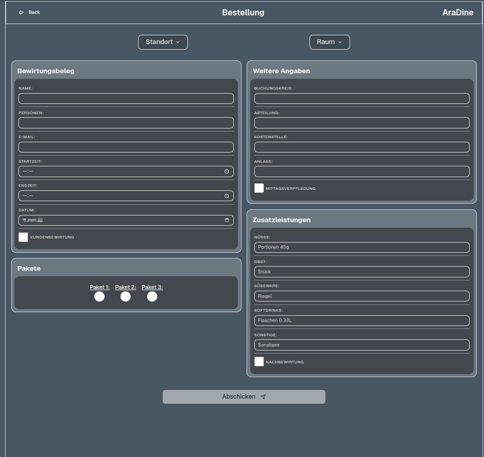

# 🍽️ Aradine – Bewirtungsmanagement

Web-App, die den kompletten Ablauf einer Bewirtung digital abbildet –
von der Buchung über die Verzehrerfassung bis zur Abrechnung.

**[Live-Demo](https://silentcrouwd.github.io/araDine/)** · Login: einfach mit einer beliebigen (fiktiven) E-Mail-Adresse registrieren



## Die Idee

Aus meinem Arbeitsalltag in der Gastronomie kenne ich den Ablauf von Bewirtungen aus erster Hand:
Kunden füllen eine Bewirtung im Intranet aus, sie wird ausgedruckt und aufgehängt – und dort
auch mal vergessen. Danach wird ein weiterer Zettel ausgefüllt, an die Betriebsleitung
zurückgeschickt und erst dann abgerechnet.

Viel Papier, viele Übergaben, viele Stellen, an denen etwas verloren gehen kann.
**Aradine bringt diesen Ablauf an einen Ort.**

Die Idee, Planung und Umsetzung sind meine eigenen – entstanden als Abschlussprojekt
meiner Weiterbildung bei devkarriere.

## Funktionen

Aradine hat drei Ansichten – eine für jede Station im Ablauf:

**Besteller**
- Bewirtung bestellen mit Auswahl von Standort und Raum
- Automatische Prüfung auf Überschneidungen mit sofortigem Feedback, ob der Raum buchbar ist

**Mitarbeiter**
- Dashboard mit allen anstehenden Bewirtungen
- Erfassung des tatsächlichen Verzehrs
- Bewirtung als abrechenbar markieren

**Betriebsleitung**
- Monatsübersicht aller Bewirtungen mit ihrem Status
- Abrechenbare Posten auf einen Blick

## Tech-Stack

React · TypeScript · Vite · Tailwind CSS · shadcn/ui · Supabase (Auth, Datenbank) · Oxlint · GitHub Actions

## Die größte Herausforderung: Formular-Verwaltung

Eine Buchung besteht aus **vier Formularbereichen**, die in unterschiedlichen
Komponenten liegen, aber mit **einem einzigen Submit** gemeinsam abgeschickt werden.
Dabei dürfen nicht alle Felder pauschal übernommen werden.

**Erster Ansatz:** Ein zentraler State für alle Felder.
Das funktionierte, wurde aber schnell groß, unübersichtlich und schwer zu warten.

**Lösung:** Alle vier Bereiche liegen in einem gemeinsamen `<form>`-Element.
Jedes Feld bekommt einen `name` mit Präfix für seinen Bereich (z. B. `main_`).
Beim Submit durchlaufe ich `formData.entries()`, filtere nach Präfix
und entferne ihn wieder – so entsteht pro Bereich ein sauberes Objekt
(`main_delivery` → `delivery`).

```ts
const main: Record<string, FormDataEntryValue> = {};
for (const [key, value] of formData.entries()) {
  if (key.startsWith("main_")) {
    main[key.slice("main_".length)] = value;
  }
}
```

**Ergebnis:** kein aufgeblähter State mehr, und die Formular-Komponenten
bleiben unabhängig voneinander.

## Was ich gelernt habe

Ich habe die Formular-Logik bewusst ohne Bibliothek umgesetzt, um zu verstehen,
wie Formulare in React unter der Haube funktionieren – und um unnötige
Abhängigkeiten zu vermeiden. Für künftige Projekte wäge ich je nach Umfang ab,
ob eine eigene Lösung oder eine etablierte Bibliothek die bessere Wahl ist.

## Nächste Schritte

- [ ] Rollen und Berechtigungen in Supabase – aktuell sind alle drei Ansichten für jeden angemeldeten Nutzer erreichbar

## Lokal starten

```bash
git clone https://github.com/SilentCrouwd/araDine.git
cd araDine
npm install
```

`.env`-Datei im Projektordner anlegen:

```env
VITE_SUPABASE_URL=deine-supabase-url
VITE_SUPABASE_PUBLISHABLE_KEY=dein-publishable-key
```

Das Datenbank-Schema liegt unter `supabase/migrations`.

```bash
npm run dev
```
